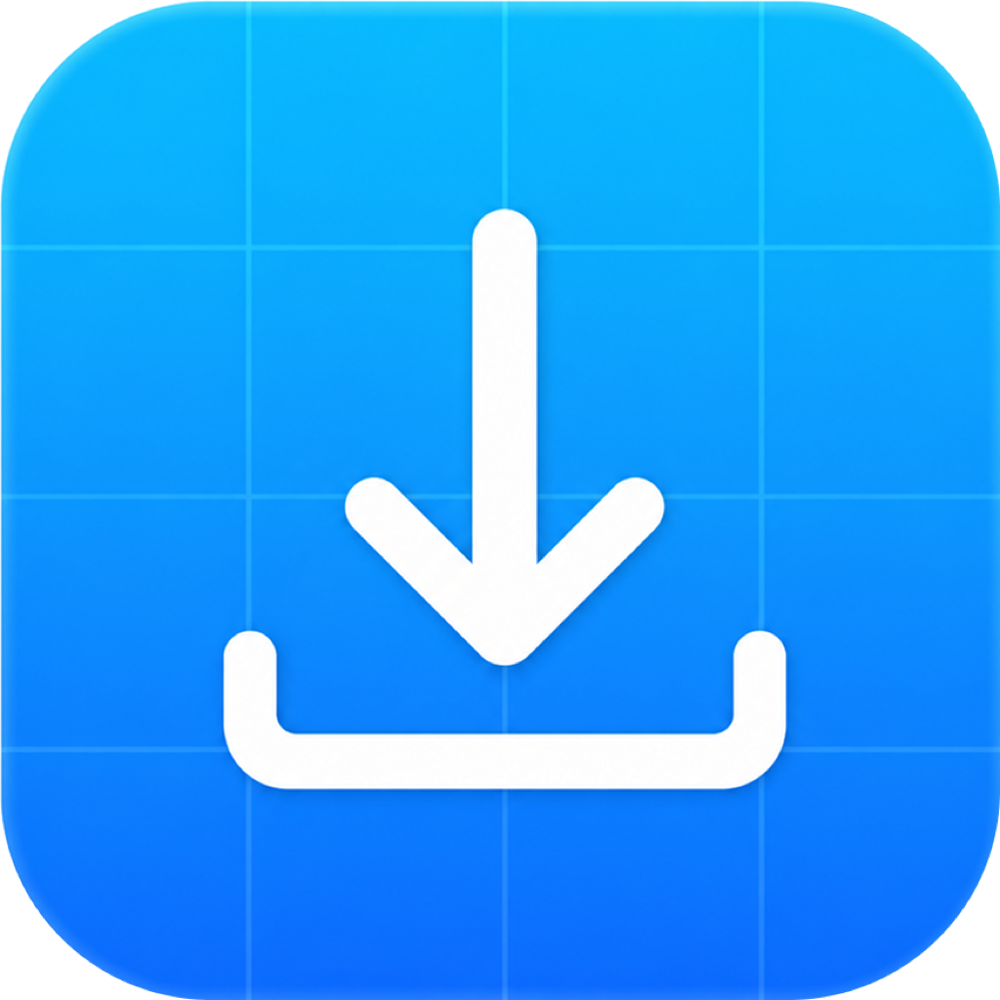

+
<div align="center">

  

  <h1>Download It</h1>

  <p><b>A beautiful, native macOS downloader — for video, images, and PDFs.</b></p>

  <p>
    Paste a link, pick a quality, done.<br/>
    No setup, no Homebrew, no Terminal.
  </p>

<p>
  <a href="https://github.com/arnabbagxd/Downloader/releases/latest"></a>
  <a href="https://github.com/arnabbagxd/Downloader/releases"></a>
  <a href="https://github.com/arnabbagxd/Downloader/stargazers"></a>
</p>

  <p>
    <a href="https://github.com/arnabbagxd/Downloader/releases/latest"><b>Download</b></a>
    &nbsp;·&nbsp;
    <a href="#installation">Install guide</a>
    &nbsp;·&nbsp;
    <a href="#build-from-source">Build from source</a>
    &nbsp;·&nbsp;
    <a href="#privacy">Privacy</a>
  </p>

</div>

---

Download It is a focused, Spotlight-style window that sits on top of everything else. Paste a link from YouTube, Instagram, X, TikTok, Vimeo, Reddit, Pinterest, and [thousands of other sites](https://github.com/yt-dlp/yt-dlp/blob/master/supportedsites.md), and it detects the available quality, downloads it, copies the finished file to your clipboard, and files it away in a searchable local history — all without you ever touching a terminal.

> [!NOTE]
> First launch downloads two small helper tools automatically (~60 MB, one time). You don't install anything yourself.

---

## Features

### Download anything

- **Thousands of sites** — anything [`yt-dlp`](https://github.com/yt-dlp/yt-dlp) supports: YouTube, Instagram, X, TikTok, Vimeo, Reddit, and more
- **Pick your quality** — the app probes the link and shows the real available resolutions (up to 4K/8K) as selectable boxes, not a guess
- **Playlists & channels** — paste a playlist or channel URL and Download It offers to grab every video in one go, with live per-item progress
- **Pinterest boards & Idea Pins** — a board or multi-page pin downloads as a bundle: choose a single `.zip` or separate files, and pick an image format for any photos inside it
- **Instagram profiles** — paste a full profile link and download everything it's posted, same zip-or-separate-files choice as Pinterest
- **Paste, drag-and-drop, or copy-paste a file** — links and local files both work, including raw image/PDF data dragged out of apps like Preview that don't hand over a file path

### Convert images and PDFs

- Convert to **JPG, PNG, WebP, or AVIF**, with a quality slider for the lossy formats
- **PDF → images** — drop or paste a PDF and every page renders out as its own image, ready to save in any of the four formats above
- Works on downloaded media, files already on your Mac, or images spotted inside a web page

### Built for speed and clarity

- **Live progress** — a filling pie indicator shows real download progress, not a spinner with no context
- **No wasted re-encoding** — video is remuxed into MP4 instead of being force-transcoded, so most downloads finish in seconds instead of minutes
- **Trim clips** — scrub to an in/out point and save the trimmed MP4 or copy it straight to your clipboard
- **Local history with thumbnails** — copy again, reveal in Finder, reopen the original link, or swipe a row to delete it
- **Global hotkey** — bring the window to front from anywhere (⌘⇧6 by default, customizable), plus configurable shortcuts for copy and trim
- **Custom download folder**, remembered across launches
- **In-app updates** — checks GitHub Releases and offers to install new versions from the settings menu

---

## Download

<div align="center">

<a href="https://github.com/arnabbagxd/Downloader/releases/latest"></a>

</div>

---

## Installation

1. Grab the latest `DownloadIt-macos-universal.dmg` from the link above.
2. Open it and drag **Download It** into your **Applications** folder.
3. Double-click to open it.

> [!IMPORTANT]
> Download It isn't notarized by Apple yet, so macOS shows a one-time security prompt on first launch — this is normal for any app distributed outside the App Store without a paid developer account, not a sign anything is wrong. It takes about 10 seconds and you only do it once: see the [full walkthrough](docs/INSTALL.md).

On first launch, the app downloads `yt-dlp` and `ffmpeg` for you (~60 MB) — just stay connected to the internet for that first run. If you already have both on your `PATH` (e.g. via `brew install yt-dlp ffmpeg`), Download It uses those instead.

---

## Updating

Download It checks GitHub Releases for new versions from the settings menu and walks you through installing them — no need to re-download manually or repeat the "Open Anyway" step.

You can also grab any past version from the [releases page](https://github.com/arnabbagxd/Downloader/releases).

---

## Build from source

### Prerequisites

- macOS 14 or newer
- Xcode Command Line Tools or Xcode with Swift 5.9+

```sh
xcode-select --install
```

### Clone and run

```sh
git clone https://github.com/arnabbagxd/Downloader.git
cd Downloader
./script/build_and_run.sh
```

This runs `swift build`, creates a local development app bundle at `dist/Download It.app`, and launches it.

Or work with SwiftPM directly:

```sh
swift build
swift test   # requires full Xcode (XCTest); Command Line Tools alone can't run tests
```

Useful `build_and_run.sh` modes:

```sh
./script/build_and_run.sh --verify     # sanity-check the build
./script/build_and_run.sh --logs       # tail the app's logs
./script/build_and_run.sh --telemetry  # include telemetry output
./script/build_and_run.sh --debug      # attach a debugger-friendly build
./script/build_and_run.sh --setup      # re-run first-time tool setup
```

---

## Releasing

There are two ways to package a distributable build.

### Free, ad-hoc-signed (no Apple Developer account needed)

```sh
./script/package_free.sh
```

Ad-hoc signs and builds a universal (Apple Silicon + Intel) `.dmg` at `dist/release/`. Not notarized, so users see the one-time "Open Anyway" prompt described above — this is the path used for the public releases today.

### Signed and notarized (requires an Apple Developer Program membership)

1. Copy `.env.example` to `.env` and fill in your Developer ID signing identity and App Store Connect API key. Never commit `.env`, `.p8`, `.p12`, certificates, or private keys — the repo already ignores them.
2. Build, sign, notarize, and publish in one step:

   ```sh
   ./script/release_macos.sh v1.3.0
   ```

   Runs the tests, builds a release app, signs it with a hardened runtime, submits it for notarization, staples the ticket, creates `dist/release/DownloadIt-macos-<arch>.zip` and `.dmg`, and uploads both to a matching GitHub release.

3. Or build the same signed, notarized artifacts locally without publishing:

   ```sh
   ./script/package_macos.sh
   ```

The in-app updater checks `https://api.github.com/repos/arnabbagxd/Downloader/releases/latest` and compares the tag (e.g. `v1.3.0`) against `CFBundleShortVersionString`, so release tags should keep the `v` prefix.

---

## How it works

Download It shells out to `yt-dlp` to resolve and fetch media, and to `ffmpeg` to remux, convert, trim, and export files — both run as managed local binaries, downloaded and kept current automatically. PDF pages are rasterized with the system's own PDFKit, no extra dependency required.

Downloads land in the folder you choose. Preferences live in `UserDefaults`; history entries and generated thumbnails live under the app's Application Support directory.

## Project structure

- `Package.swift` — Swift Package Manager manifest
- `Sources/MediaDownloader` — app source (`App`, `Models`, `Services`, `Stores`, `Views`, `Support`)
- `Tests/MediaDownloaderTests` — unit tests
- `script/build_and_run.sh` — local build, bundle, launch, debug, and logging helper
- `script/package_free.sh` — free, ad-hoc-signed universal `.dmg` (no Apple account)
- `script/package_macos.sh` — signed, notarized local artifacts
- `script/release_macos.sh` — signed, notarized artifacts published to a GitHub release
- `script/create_dmg.sh` — builds the drag-to-Applications `.dmg` from an app bundle
- `docs/INSTALL.md` — end-user install walkthrough
- `dist/` — generated local build output (git-ignored)

---

## Privacy

Download It runs entirely on your Mac. History, preferences, and thumbnails stay local — nothing about what you download is collected or sent anywhere.

The app talks to the network for exactly three things: fetching the media you ask for, checking GitHub Releases for updates, and downloading/updating its `yt-dlp`/`ffmpeg` helpers. Nothing else.

---

## Notes

Site support depends on the installed `yt-dlp` version. If a site stops working, update it:

```sh
brew upgrade yt-dlp
```

(Or just relaunch Download It — it runs `yt-dlp -U` in the background on its own when it's managing the binary itself.)

---

## Credits

Built on [`yt-dlp`](https://github.com/yt-dlp/yt-dlp) and [`ffmpeg`](https://ffmpeg.org/) — see [NOTICE.md](NOTICE.md) for full attribution and licensing. Icons by [Lucide](https://lucide.dev).
